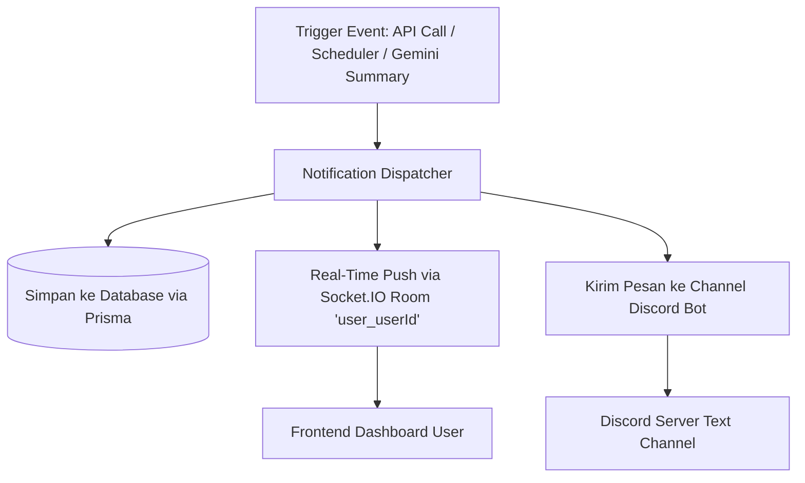

# 🚀 JunAI Backend API & Database Documentation

Dokumentasi inisialisasi database Prisma, arsitektur RESTful API yang terstruktur, dan sistem notifikasi real-time terintegrasi (Socket.IO + Cron Scheduler + Discord Bot).

---

## 🗄️ 1. Database & Prisma ORM

Skema database diterjemahkan langsung dari spesifikasi DBML di [initializationDatabase.db](file:///d:/Work/JunAI/backend/src/config/db/initializationDatabase.db) ke [schema.prisma](file:///d:/Work/JunAI/backend/prisma/schema.prisma).

### Entitas / Model:
1. **`Role`** (`roles`): Manajemen hak akses (`id`, `name`, `code`, `is_active`, `timestamps`)
2. **`User`** (`users`): Pengguna sistem (`username`, `email`, `password_hash`, `status`, `role_id`, dll)
3. **`MeetWise`** (`meetwise_documents`): Dokumen meeting/notulensi (`name_document`, `author_id`, `is_deleted`, dll)
4. **`DocumentHistory`** (`document_histories`): Riwayat versi dokumen meeting
5. **`Notification`** (`notifications`): Notifikasi user (`title`, `message`, `type`, `user_id`, `is_read`, dll)
6. **`Reminder`** (`reminders`): Pengingat rapat/aktivitas (`title`, `timeline_activity`, `type`, `user_id`)
7. **`ChatSubReminderHistory`** (`chat_sub_reminder_histories`): Sesi chat pengingat
8. **`ChatReminderHistoryDetail`** (`chat_reminder_history_details`): Isi pesan percakapan reminder

### Enums:
- `ReminderTypeName`: `KICK_OFF` ("Kick Off"), `DEADLINE` ("Deadline"), `FOLLOW_UP` ("Follow Up"), `CUSTOM` ("Custom")
- `NotificationTypeName`: `MEETING_REMINDER` ("Meeting Reminder"), `MEETING_STARTED` ("Meeting Started"), `MEETING_ENDED` ("Meeting Ended")
- `StatusUserName`: `ACTIVE` ("Active"), `INACTIVE` ("Inactive"), `SUSPENDED` ("Suspended")

### Perintah Database:
```bash
# Push schema langsung ke database (tanpa file migration)
npm run prisma:push

# Generate migration baru
npm run prisma:migrate

# Jalankan seeder (membuat default role admin, user, dan sample reminder)
npm run prisma:seed

# Buka Prisma Studio GUI untuk melihat data
npm run prisma:studio
```

---

## 🧱 2. Arsitektur RESTful API

Struktur folder dibangun dengan arsitektur berlapis (Clean/Layered Architecture) yang rapi dan terisolasi:

```
backend/src/
├── config/
│   ├── database.js          # Prisma Client Singleton
│   ├── socket.js            # Socket.IO instance & connection handlers
│   ├── discord.js           # Discord.js bot client
│   └── multer.js            # File upload config
├── controllers/             # Layer penanganan request & response HTTP
│   ├── user/
│   ├── role/
│   ├── meetwise/
│   ├── reminder/
│   ├── notification/
│   ├── chat/
│   ├── gemini/
│   └── discord/
├── services/                # Layer Business Logic & Database Queries (Prisma)
│   ├── user/
│   ├── role/
│   ├── meetwise/
│   ├── reminder/
│   ├── notification/        # Notification service, dispatcher, scheduler, discord push
│   ├── chat/
│   └── discord/
├── routes/                  # Layer routing HTTP Express
│   ├── index.js             # Central aggregator router (/api/v1)
│   ├── user/
│   ├── role/
│   ├── meetwise/
│   ├── reminder/
│   ├── notification/
│   └── chat/
├── middleware/
│   ├── asyncHandler.middleware.js   # Wrapper async untuk menghindari repetitive try-catch
│   └── errorHandler.middleware.js   # Global error handler (Prisma error & AppError)
└── utils/
    ├── response.util.js     # Standardized JSON response (sendSuccess, sendPaginated, sendError)
    └── errors.util.js       # Custom operational errors (NotFoundError, ValidationError, etc.)
```

### Endpoints Utama (`/api/v1`):

#### 👥 Users (`/api/v1/users`)
- `GET /api/v1/users?page=1&limit=10&search=john` — List user dengan paginasi & search
- `GET /api/v1/users/:id` — Detail user
- `POST /api/v1/users` — Buat user baru
- `PUT /api/v1/users/:id` — Update user
- `DELETE /api/v1/users/:id` — Soft delete user

#### 🔑 Roles (`/api/v1/roles`)
- `GET /api/v1/roles` — List role
- `POST /api/v1/roles` — Buat role baru

#### 📄 MeetWise Documents (`/api/v1/documents`)
- `GET /api/v1/documents?page=1&limit=10` — List dokumen notulensi
- `GET /api/v1/documents/:id` — Detail dokumen beserta riwayat
- `POST /api/v1/documents` — Simpan dokumen baru

#### ⏰ Reminders (`/api/v1/reminders`)
- `GET /api/v1/reminders?userId=1` — List reminder user
- `POST /api/v1/reminders` — Buat reminder aktivitas

#### 🔔 Notifications (`/api/v1/notifications`)
- `GET /api/v1/notifications?userId=1&isRead=false` — List notifikasi
- `GET /api/v1/notifications/unread-count/:userId` — Jumlah notifikasi belum dibaca
- `POST /api/v1/notifications` — Buat & langsung dispatch notifikasi ke Socket.IO & Discord
- `PATCH /api/v1/notifications/:id/read` — Tandai satu notifikasi sudah dibaca
- `PATCH /api/v1/notifications/read-all` — Tandai semua notifikasi dibaca

#### 💬 Chat Histories (`/api/v1/chats`)
- `GET /api/v1/chats?userId=1` — List sesi riwayat chat
- `POST /api/v1/chats/:id/messages` — Tambah pesan dalam sesi chat

---

## 🔔 3. Cara Kerja Sistem Notifikasi

Alur kerja notifikasi diimplementasikan secara terpadu melalui **`dispatchNotification`**:



1. **Penyimpanan Database**: Notifikasi otomatis tersimpan di tabel `notifications` dengan flag `is_read = false`.
2. **Real-Time via Socket.IO**:
   - Client frontend terhubung dan mengirim event `join` dengan `userId`.
   - Server memancarkan event `notification:new` langsung ke room user (`user_${userId}`).
   - Server juga memancarkan `notification:broadcast` untuk dashboard admin / global monitor.
3. **Pemberitahuan Eksternal Discord**:
   - Jika Discord bot aktif, notifikasi otomatis diposting ke text channel yang ditentukan (`DISCORD_NOTIFICATION_CHANNEL_ID` atau fallback channel).
4. **Otomatisasi Cron Scheduler (`node-cron`)**:
   - Berjalan di background setiap menit (`* * * * *`).
   - Mencari reminder di tabel `reminders` yang jatuh tempo pada rentang waktu saat ini.
   - Jika ada reminder yang waktunya tiba, langsung memanggil `dispatchNotification` secara otomatis.
5. **Integrasi Gemini AI Meeting Summarizer**:
   - Setelah AI selesai memproses audio meeting dan menghasilkan file PDF notulensi rapat, sistem otomatis memicu notifikasi `MEETING_ENDED` ke user terkait.
